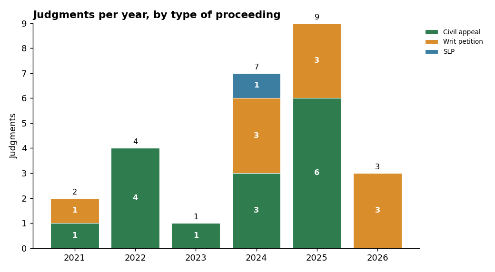

# Environmental Pollution and Environmental Protection in the Supreme Court of India, 2021 to 2026

**Live analysis page:** see the GitHub Pages link in this repository's "About" panel (`index.html`). Data: `data.xlsx` and `data.csv`.

## Team

Team Green Justice
- Pavanikha, Division B
- Riddhi, Division A
- Shreya, Division A

## Topic

This project examines how the Supreme Court of India has addressed environmental pollution and environmental protection through judgments and substantive orders from September 2021 to October 2026. We focus on industrial and river pollution, air quality, waste management, environmental clearances, mining, wetlands and ecological restoration. The topic interests us because environmental disputes connect constitutional rights, public health, scientific evidence and the responsibilities of industries and public authorities.

## How we found the judgments

We used the Supreme Court of India judgments portal and legal repositories including Indian Kanoon, Supreme Court Observer, VoxJuris and Law Observer. Search terms included "industrial pollution", "river pollution", "air pollution", "effluent discharge", "environmental clearance", "post-facto clearance", "fly ash", "solid waste", "wetlands", "sand mining", "pollution control board" and "environmental compensation". We did not keep a reliable count of raw search results, so we do not give a figure. We screened candidates dated 1 September 2021 to 30 October 2026 that directly concerned pollution, pollution regulation or a closely connected safeguard. We kept 26 judgments or substantive orders that had an identifiable case name, date, citation or case number, and a reported issue and result. Some are orders in continuing proceedings, so this is a selected dataset, not a complete census.

## What the data shows

The count is 2 in 2021, 4 in 2022, 1 in 2023, 7 in 2024, 9 in 2025 and 3 in 2026 (a part year). 2025 is the largest group. What surprised us is how uneven the spread is, with 16 of the 26 records from 2024 and 2025. These figures describe our sample, not the Court's total caseload.

Seven matters are coded allowed, four dismissed, three partly allowed and twelve "other". "Other" covers continuing directions, procedural orders and split opinions. We expected more clear wins and losses, but environmental cases often end in supervision and directions.

We grouped the detailed theme labels into eight broader themes. Environmental clearances is the largest (7), followed by river and water pollution (4), ecology and biodiversity (4), waste management (3) and industrial pollution (3). We were struck by how often the Court reviews regulatory process, such as appraisal and approvals, and not only the pollution itself.

Companies and associations or NGOs each account for seven entries, individuals and "other" (including suo motu proceedings) for five each, and State or public bodies for two. We did not expect NGOs and companies to appear equally often. This records the formal applicant, not everyone affected by pollution.

Eleven matters are coded mixed or unclear, five went to companies, four to State or public bodies, and three each to individuals and associations or NGOs. The large mixed group reflects orders that direct regulators or require reconsideration without a conventional winner.

There are fifteen civil appeals, ten writ petitions (including suo motu proceedings) and one special leave petition. We were surprised by the range of procedural routes used for environmental disputes.

We grouped legislation into four categories: Water and Air Acts (11), sector-specific laws and rules (7), the Environment (Protection) Act with the EIA framework (7), and the Environment (Protection) Act alone (1). Pollution litigation rarely rests on one statute. Each record carries one primary category even where several laws apply.

Pavanikha and Riddhi coded nine records each and Shreya eight, a near-equal split. "Coded by" names the member who entered and summarised a record, not the only person who reviewed it.

## Limits

These 26 records cannot show how often the Supreme Court rules for polluters, regulators or affected communities, and they do not represent every environmental judgment in the period. Some proceedings continue, some entries are orders within larger cases, and the theme, outcome and "who won" labels are simplified coding choices. Read the linked judgment before relying on any summary.

## AI-use disclosure

ChatGPT helped organise the workbook, standardise categories, draft issue and holding summaries and calculate chart counts. Claude (Anthropic) helped build the analysis webpage, draw the charts and format this README. We checked details against linked Supreme Court PDFs where available, and against legal repositories where an official copy was not readily located. Some links are still to secondary sources, so a reader should confirm dates, benches, case numbers and holdings against the signed judgment.
